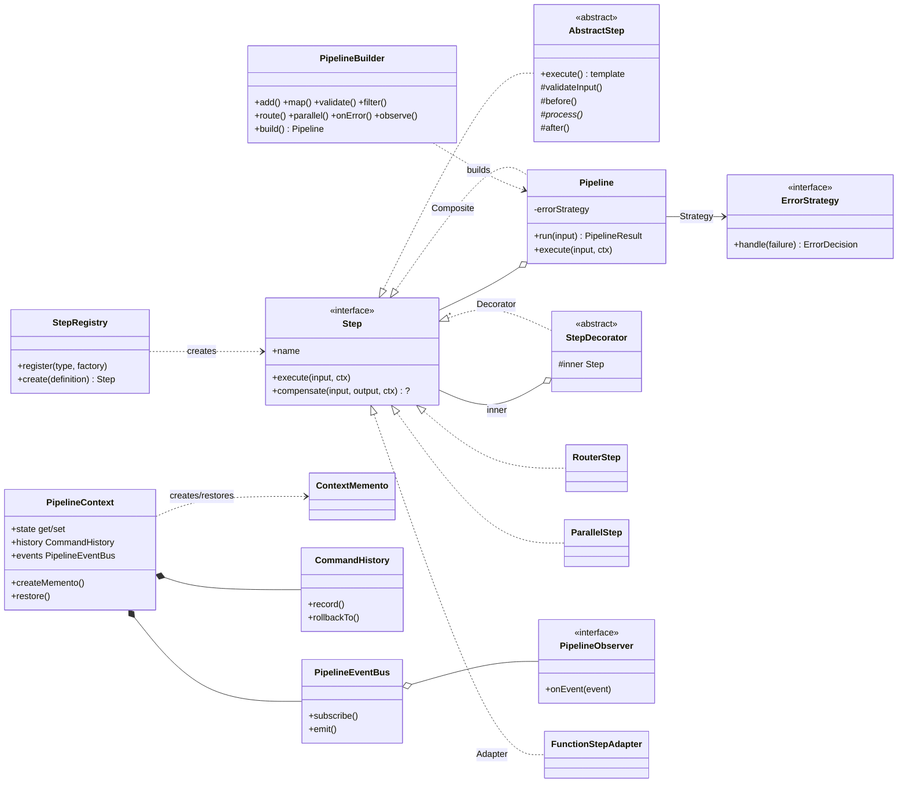
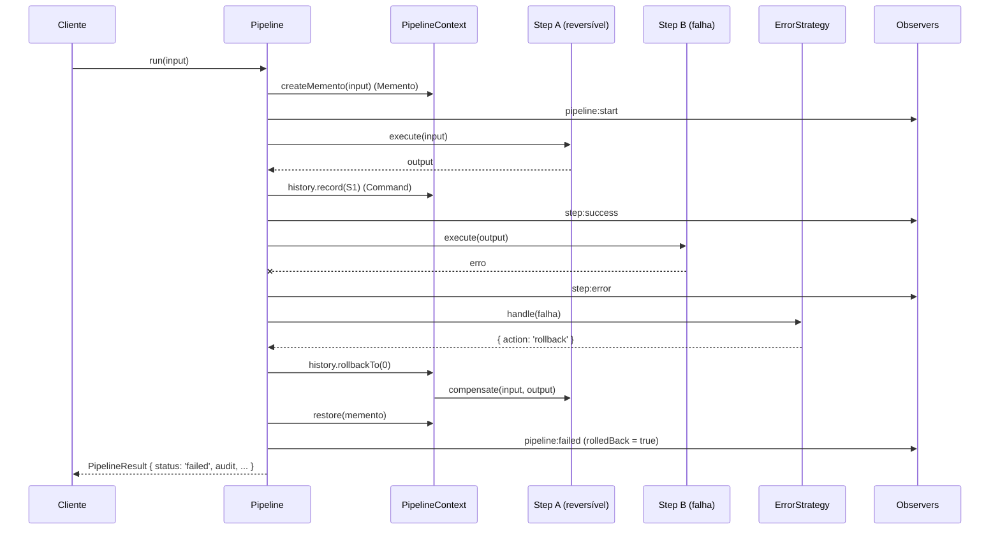

# Arquitetura do pipeforge

Este documento é a base da **defesa arquitetural**: para cada padrão, onde está no código, qual
problema de design resolve e por que foi a escolha adequada.

## Problema que a biblioteca resolve

Aplicações precisam encadear etapas sobre dados em memória (validar → transformar → filtrar →
rotear → gravar). Feito à mão, isso vira uma função enorme em que: (1) a ordem e as dependências
ficam escondidas; (2) cada etapa trata erros do seu jeito; (3) não há como desfazer o que já foi
feito quando uma etapa tardia falha; (4) não há auditoria; (5) trocar ou acrescentar uma etapa
obriga a editar a função inteira.

`pipeforge` é um micro-framework que separa **o que cada etapa faz** (Step) de **como o fluxo é
conduzido** (Pipeline), com falha, rollback, auditoria e extensão tratados de forma uniforme.

## Visão geral

### O que acontece em uma execução com falha e rollback

## Padrões de projeto (12)

| # | Padrão | Arquivo(s) | Problema específico resolvido | Por que é a escolha adequada |
|---|---|---|---|---|
| 1 | **Builder** | `src/core/PipelineBuilder.ts` | Montar um pipeline exige informar nome, N etapas (algumas decoradas), estratégia de erro e observers. Um construtor com tudo isso seria ilegível e sem checagem de tipos entre etapas. | O builder é fluente e **imutável**: cada chamada devolve um novo builder, e os genéricos `PipelineBuilder<TInput, TOutput>` fazem o compilador conferir que a saída de uma etapa é a entrada da próxima. Dá para reaproveitar um pipeline-base em várias variantes. |
| 2 | **Composite** | `src/core/Pipeline.ts` (`Pipeline implements Step`), `RouterStep`, `ParallelStep` | Fluxos reais têm ramos e sub-fluxos. Sem uniformidade, o executor precisaria de `if (é pipeline) ... else ...` por toda parte. | `Pipeline` **é** um `Step`: sub-pipelines entram em qualquer lugar de um pipeline, de um roteador ou de um ramo paralelo. Como o contexto é compartilhado, o rollback do pipeline externo também desfaz o interno. |
| 3 | **Command** | `src/core/Step.ts`, `src/core/CommandHistory.ts` | Quando a etapa 5 falha, os efeitos colaterais das etapas 1–4 (gravar, cobrar, publicar) precisam ser desfeitos, na ordem inversa. | Cada step é um comando com `execute` e `compensate`; o `CommandHistory` guarda os já executados e os desfaz do mais novo para o mais antigo (padrão saga). O executor não sabe o que cada comando faz. |
| 4 | **Memento** | `src/core/ContextMemento.ts`, `PipelineContext.createMemento/restore` | O rollback de efeitos externos (Command) não restaura o **estado em memória** (estado compartilhado e entrada original). | O memento é um snapshot **opaco e imutável**: o `Pipeline` (caretaker) o guarda sem poder ler o conteúdo, que só o `PipelineContext` (originator) acessa via um símbolo não exportado. Encapsulamento preservado. |
| 5 | **Observer** | `src/events/PipelineEventBus.ts`, `src/events/observers/*` | Auditoria, logs, métricas e alertas não podem estar misturados ao executor, nem um observer com defeito pode derrubar o fluxo. | O executor só faz `emit`; quem quiser reagir faz `subscribe`. Vêm prontos `InMemoryAuditTrail`, `ConsoleAuditObserver` e `MetricsObserver`; o cliente cria os seus. Erros de observers são isolados. |
| 6 | **Decorator** | `src/decorators/*` | Retry, timeout, medição de tempo e cache são necessidades transversais. Herança geraria `RetryTimeoutMemoStep`... e cada step teria de reimplementá-las. | `StepDecorator` envolve qualquer `Step` mantendo a mesma interface, então os decorators se empilham (`memoize(timing(retry(timeout(step))))`). O cliente cria o seu (ex.: circuit breaker) sem tocar na lib. |
| 7 | **Strategy** | `src/strategies/*` | A política de falha varia por caso de uso: parar, ignorar, desfazer tudo, ou usar um valor reserva. Um `switch` dentro do executor o travaria para sempre nessas quatro. | `ErrorStrategy` devolve uma `ErrorDecision`; o `Pipeline` só a executa. A estratégia é trocada com `.onError(...)` e o cliente pode escrever a sua (ex.: rollback só para certos erros). |
| 8 | **Template Method** | `src/core/AbstractStep.ts` | Todo step deve seguir o mesmo ciclo (validar entrada → antes → processar → depois). Repetir isso em cada step gera inconsistência. | O esqueleto `execute()` é fixo; o cliente implementa só `process()` e, se quiser, os hooks `validateInput/before/after`. Os steps prontos (`ValidateStep`, `FilterStep`, coleções) usam essa base. |
| 9 | **Chain of Responsibility** | `src/steps/composite/RouterStep.ts` (`RouteHandler`) | Rotear entradas para tratamentos diferentes por condição sem uma cascata de `if/else` que cresce a cada nova regra. | Cada rota é um elo que trata a entrada ou a repassa ao próximo. Acrescentar uma regra é acrescentar um elo; o `otherwise` é o último elo. A rota escolhida fica registrada no contexto. |
| 10 | **Factory Method + Registry** | `src/registry/StepRegistry.ts` | Montar pipelines a partir de configuração (JSON, banco, API) exige criar steps por **nome**, e a lista de tipos não pode ser fixa no código da lib. | `register(tipo, factory)` + `create(definição)`. O cliente registra tipos novos (`'slugify'`) que passam a funcionar em JSON, sem alterar `src/`. É o ponto central de extensão declarativa. |
| 11 | **Adapter** | `src/adapters/FunctionStepAdapter.ts` | A maioria dos usuários só tem uma função `(x) => y`, mas o pipeline só entende a interface `Step`. | O adapter encaixa a função (e um `undo` opcional como `compensate`) na interface, e é o que faz `.map(fn)` e `.use(fn)` funcionarem. |
| 12 | **Facade** | `src/index.ts` (`createPipeline`, `createPipelineFromDefinition`) | A lib tem dezenas de classes (contexto, bus, history, strategies...). O iniciante só quer "montar e rodar". | Duas funções escondem a montagem; as demais classes continuam exportadas para quem quer estender. |

## Divisão sugerida para o vídeo (3 alunos × 2 padrões)

| Lote | Padrões | Trechos a mostrar |
|---|---|---|
| 1 (núcleo do motor) | **Command** + **Memento** | `Step.ts` + `CommandHistory.rollbackTo` · `ContextMemento.ts` + `Pipeline.run` · exemplo 03 |
| 2 (motor e passos prontos) | **Composite** + **Decorator** | `Pipeline.ts` (`implements Step`) · `StepDecorator.ts` + `RetryStep.ts` · exemplos 04 e 02 |
| 3 (API de uso) | **Builder** + **Factory Method + Registry** | `PipelineBuilder.ts` (imutabilidade e genéricos) · `StepRegistry.ts` · exemplo 05 |

Cada aluno defende os padrões do lote de commits que enviou. Reservas, caso o grupo prefira outros:
Observer, Strategy, Template Method, Chain of Responsibility, Adapter, Facade.

## Princípios de Clean Code e SOLID aplicados

- **Open/Closed:** todo ponto de variação é uma interface ou classe-base (`Step`, `AbstractStep`,
  `StepDecorator`, `ErrorStrategy`, `PipelineObserver`, `Rule`, `StepFactory`). Os testes de
  `tests/extensibility.test.ts` e o `examples/02` provam que dá para estender sem editar `src/`.
- **Single Responsibility:** `Pipeline` conduz o fluxo; `CommandHistory` desfaz; `PipelineEventBus`
  notifica; `ErrorStrategy` decide; `StepRegistry` cria.
- **Liskov:** qualquer `Step` (leaf, `Pipeline`, decorator, roteador) é intercambiável.
- **Interface Segregation:** `compensate` é opcional; steps puros não carregam código de desfazer.
- **Dependency Inversion:** o `Pipeline` depende das abstrações `Step`, `ErrorStrategy` e
  `PipelineObserver`, nunca de implementações concretas.
- Zero dependências de runtime, TypeScript `strict`, funções curtas, nomes descritivos, erros
  tipados (`PipelineError` e derivados) e API pública explícita em `src/index.ts`.

## Decisões de design relevantes

- **Halt não é erro.** `ctx.halt()` / `.filter()` interrompem o fluxo de propósito: o resultado é
  `status: 'halted'`, sem rollback e sem acionar a `ErrorStrategy`. Decorators (`RetryStep`) nunca
  tentam de novo um halt.
- **`run()` nunca lança por falha de etapa.** Devolve um `PipelineResult` discriminado
  (`success | failed | halted`) com a trilha de auditoria; `runOrThrow()` existe para quem prefere exceções.
- **Histórico compartilhado.** Todos os steps de uma execução, inclusive de sub-pipelines, ramos de
  roteador e ramos paralelos, gravam no mesmo `CommandHistory`; por isso o rollback é global e correto.
- **Paralelo espera todos os ramos** antes de falhar, para o histórico estar completo na hora do rollback.
- **Limite honesto:** o step que falhou não é compensado (só os que terminaram com sucesso). Um
  step que faz vários efeitos deve ser atômico ou ser dividido em steps menores.
- **`TimeoutStep` não cancela** a promessa interna (limitação do JavaScript); ele apenas deixa de esperar.
